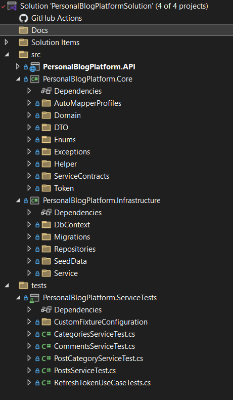

# 📝 PersonalBlogPlatform

A backend project for blogging platform built with ASP.NET Core Web API.

## 📦 Technologies Used

- ASP.NET Core Web API
- Entity Framework Core with SQL Server
- AutoMapper
- xUnit
- Moq
- JWT Authentication with Refresh Tokens
- ASP.NET Core Authorization with custom policies
- Swagger (OpenAPI)
- Serilog
- Custom middlewares
- Filters

## 📁 Project Structure (Clean Architecture)

- `PersonalBlogPlatformSolution.sln` — Solution file.  
- `PersonalBlogPlatform.API` — Entry point (Web API).  
- `PersonalBlogPlatform.Core` — Domain models, interfaces and business logic.  
- `PersonalBlogPlatform.Infrastructure` — EF Core implementation, DbContext, migrations.  
- `PersonalBlogPlatform.ServiceTests` — Unit tests.

## The project follows Clean Architecture principles:

- Separation of concerns between layers

- Dependency Inversion (core does not depend on infrastructure)

- Testability 

## 🖼 Folder Structure

